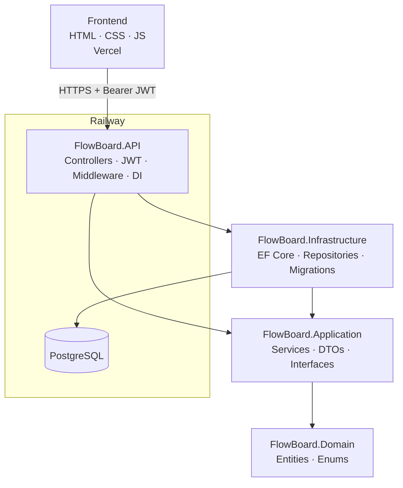
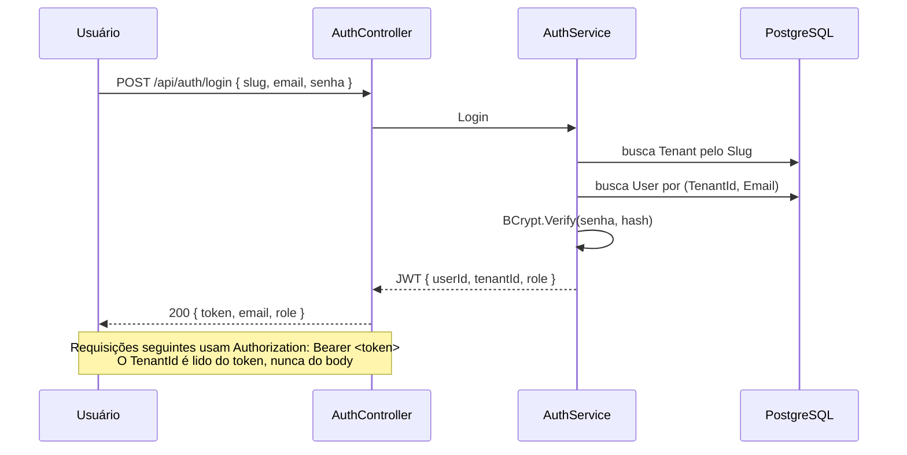
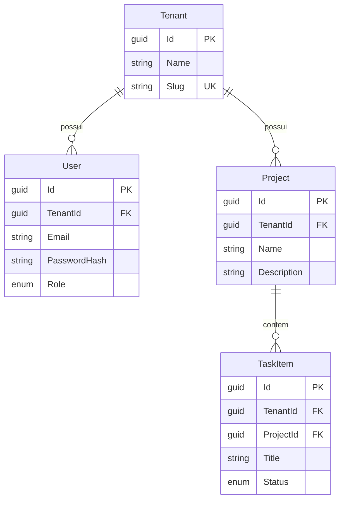
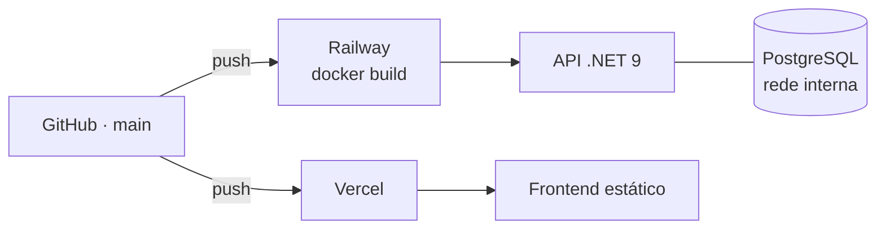

# ⚡ FlowBoard

> SaaS de gerenciamento de tarefas **multi-tenant** no estilo Kanban, com ASP.NET Core 9, Clean Architecture, JWT e deploy completo em nuvem.


> 🇺🇸 **TL;DR (English):** multi-tenant Kanban SaaS built with ASP.NET Core 9 and Clean Architecture. Every company gets an isolated workspace; the tenant is resolved from the JWT and never from the request body. It uses EF Core with PostgreSQL, BCrypt password hashing and role-based access (Admin/Member), with a Dockerized API on Railway and a static frontend on Vercel.

## 🌐 Demo

| | |
|---|---|
| 🖥️ Frontend | [flow-board-rouge.vercel.app](https://flow-board-rouge.vercel.app) |
| ⚙️ API | [flowboard-production-5220.up.railway.app](https://flowboard-production-5220.up.railway.app) |
| 🩺 Health check | [/api/health](https://flowboard-production-5220.up.railway.app/api/health) |

Para testar, clique em **"Criar conta grátis"**. O cadastro gera o workspace e o usuário Admin.

---

## 📌 Destaques técnicos

- **Multi-tenancy com isolamento por `TenantId`**: o tenant vem *sempre* da claim do JWT, então um usuário não consegue ler nem alterar dados de outra empresa.
- **Clean Architecture** em 4 projetos (`Domain` → `Application` → `Infrastructure` → `API`), com as dependências apontando para o núcleo.
- **Repository pattern + injeção de dependência**: os serviços de aplicação dependem de interfaces (`IUserRepository`, `ITaskRepository`, `IJwtService`...).
- **Autenticação stateless** com JWT (claims `userId`, `tenantId`, `role`) e senhas com **BCrypt**.
- **Autorização por perfil** (Admin / Member): só Admin cadastra novos usuários.
- **Middleware global de exceções** com resposta JSON padronizada.
- **EF Core Migrations aplicadas no startup**: o banco de produção sobe sem passo manual.
- **Deploy contínuo**: push na `main` dispara o build Docker no Railway e o deploy do frontend no Vercel.

---

## 🏗️ Arquitetura



```
FlowBoard/
├── FlowBoard.Domain/          # Entidades (Tenant, User, Project, TaskItem) e enums. Sem dependências externas
├── FlowBoard.Application/     # Casos de uso (AuthService, ProjectService, TaskService), DTOs e interfaces
├── FlowBoard.Infrastructure/  # AppDbContext, repositórios e migrations (EF Core + Npgsql)
├── FlowBoard.API/             # Controllers, JwtService, ExceptionMiddleware, Program.cs
├── HashGen/                   # Utilitário de console para gerar hashes BCrypt
├── frontend/                  # index (login), register, dashboard (Kanban)
├── Dockerfile                 # Build multi-stage (.NET SDK → ASP.NET runtime)
└── railway.json               # Healthcheck do deploy
```

---

## 🔐 Fluxo de autenticação



---

## 🛢️ Modelo de dados



- Índice único em `Tenant.Slug` e em `(TenantId, Email)`: o mesmo e-mail pode existir em empresas diferentes.
- Índice em `TenantId` em todas as tabelas, já que todas as consultas filtram por tenant.
- `TaskItemStatus`: `Todo` · `InProgress` · `Done` (as três colunas do Kanban).

---

## 📡 Endpoints

| Método | Rota | Auth | Descrição |
|---|---|---|---|
| POST | `/api/auth/register-tenant` | — | Cria empresa + usuário Admin |
| POST | `/api/auth/login` | — | Login com slug + e-mail + senha |
| POST | `/api/auth/register-user` | Admin | Cadastra membro no tenant |
| GET | `/api/users` | JWT | Lista usuários do tenant |
| GET | `/api/projects` | JWT | Lista projetos do tenant |
| POST | `/api/projects` | JWT | Cria projeto |
| PUT | `/api/projects/{id}` | JWT | Edita projeto |
| DELETE | `/api/projects/{id}` | JWT | Remove projeto |
| GET | `/api/tasks/project/{projectId}` | JWT | Lista tarefas do projeto |
| POST | `/api/tasks` | JWT | Cria tarefa |
| PATCH | `/api/tasks/{id}/status` | JWT | Move a tarefa no Kanban |
| DELETE | `/api/tasks/{id}` | JWT | Remove tarefa |
| GET | `/api/health` | — | Health check |

O Swagger fica disponível em `/swagger` no ambiente de desenvolvimento.

---

## ▶️ Como rodar localmente

**Pré-requisitos:** [.NET 9 SDK](https://dotnet.microsoft.com/download) e Docker (ou um PostgreSQL local).

```bash
git clone https://github.com/rbarboteu/FlowBoard.git
cd FlowBoard

# 1. PostgreSQL local
docker run -d --name flowboard-db -p 5432:5432 \
  -e POSTGRES_PASSWORD=postgres -e POSTGRES_DB=flowboard postgres:16

# 2. API (as migrations são aplicadas automaticamente no startup)
dotnet run --project FlowBoard.API
```

A API sobe em `http://localhost:5291` e o Swagger fica em `http://localhost:5291/swagger`.

A connection string padrão em `FlowBoard.API/appsettings.json` já aponta para esse container. Para usar outro banco, sobrescreva por variável de ambiente:

```bash
export ConnectionStrings__DefaultConnection="Host=...;Database=...;Username=...;Password=..."
export Jwt__Secret="uma-chave-com-no-minimo-32-caracteres"
```

**Frontend:** os arquivos em `frontend/` são estáticos. Para apontar para a API local, troque a constante `API` no início de `frontend/app.js` e abra `frontend/index.html` no navegador.

---

## ☁️ Deploy



- O `Dockerfile` é multi-stage: publica com o SDK e roda só com o runtime ASP.NET, escutando na `PORT` do Railway.
- O `Program.cs` aceita tanto a connection string no formato Npgsql quanto uma URL `postgres://`, que converte automaticamente.
- O `railway.json` configura o healthcheck em `/api/health`.

| Variável (Railway) | Descrição |
|---|---|
| `ConnectionStrings__DefaultConnection` | Conexão PostgreSQL |
| `Jwt__Secret` | Chave de assinatura do JWT (≥ 32 caracteres) |
| `Jwt__Issuer` / `Jwt__Audience` | Emissor e público do token |
| `ASPNETCORE_ENVIRONMENT` | `Production` |

---

## 🔒 Segurança

- Senhas armazenadas apenas como hash **BCrypt**.
- JWT validado em issuer, audience, assinatura e expiração (8 horas).
- `TenantId` extraído do token em todas as operações, nunca aceito do cliente.
- Os segredos de produção vêm de variáveis de ambiente. Os valores em `appsettings*.json` servem só para desenvolvimento local.
- O CORS está aberto para facilitar a demo; em produção real, ele seria restrito ao domínio do frontend.

---

## 🗺️ Próximos passos

- [ ] Testes de unidade (xUnit + Moq) para os services e testes de integração com `WebApplicationFactory` + Testcontainers
- [ ] Global query filter do EF Core por tenant, como segunda camada de isolamento
- [ ] Refresh token para renovar a sessão sem novo login
- [ ] Paginação e filtros na listagem de tarefas
- [ ] Pipeline de CI (build + testes) no GitHub Actions
- [ ] CORS restrito ao domínio do frontend

---

<p align="center">Desenvolvido por <a href="https://github.com/rbarboteu">Raphael Barboteu</a> · <a href="https://www.linkedin.com/in/raphael-barboteu-5827b223b/">LinkedIn</a></p>
